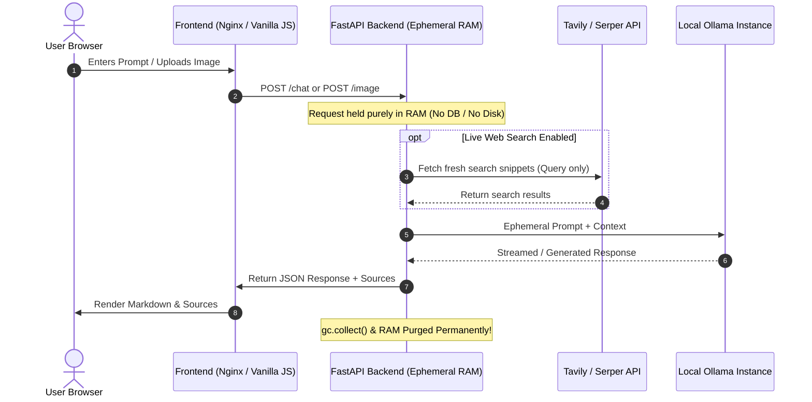

# SilentGPT 🔒⚡

> **AI that searches the internet for answers, but never stores your data. Private conversations. Zero Data Retention.**

[](LICENSE)
[](https://www.python.org/)
[](https://fastapi.tiangolo.com/)
[](https://ollama.com/)
[](https://www.docker.com/)
[](#zero-data-retention-guarantee)

SilentGPT is a **privacy-first AI chat platform** built from the ground up to guarantee absolute data confidentiality. Unlike mainstream AI services that log conversations, build user profiles, or train models on user inputs, SilentGPT operates under a strict **Zero Data Retention (ZDR)** policy. Every interaction exists exclusively in volatile RAM for the duration of request processing and is permanently wiped immediately after delivery.

---

## 🌟 Key Features

- 🛡️ **Zero Data Retention (ZDR)**: No database, no telemetry, no conversation history logging. What is never stored can never be leaked.
- 🌐 **Real-Time Web Search**: Integrates live web search (powered by **Tavily** or **Serper**) to fetch up-to-date context while keeping user identity decoupled.
- 👁️ **Multimodal Vision Analysis**: Upload and query images seamlessly. Images are processed in-memory and instantly purged after inference.
- 🦙 **Local LLM Inference**: Powered by **Ollama** running locally on your hardware (supports Llama 3.1, Phi-3, LLaVA, and more) for complete sovereignty over your data.
- 🎨 **Sleek Glassmorphic UI**: Cyberpunk-inspired dark aesthetic featuring real-time matrix and particle waves, smooth transitions, and responsive mobile/desktop design.
- 🐳 **Containerized & Ready to Deploy**: Full Docker Compose setup with isolated backend and lightweight Nginx frontend.

---

## 🏗️ Architecture & Data Flow



---

## 📊 Zero Data Retention Guarantee

| Component | Policy & Behavior |
|---|---|
| **Database** | **None.** No SQLite, PostgreSQL, MongoDB, Redis, or local storage. |
| **Disk Storage** | Files & images are processed as byte buffers directly in RAM and **never written to disk**. |
| **Logging** | Server lifecycle and errors are tracked, but **user prompts, queries, and images are strictly unlogged**. |
| **Memory Lifecycle** | Prompt variables and image buffers are explicitly cleared (`del`, `gc.collect()`) in `finally` blocks. |
| **AI Processing** | Ollama runs entirely stateless inference. No multi-turn chat sessions or telemetry are saved. |

---

## 🚀 Quick Start

### Option 1: Docker Compose (Recommended)

1. **Clone the repository:**
   ```bash
   git clone https://github.com/prem2078/SilentGPT.git
   cd SilentGPT
   ```

2. **Configure environment variables:**
   ```bash
   cp backend/.env.example backend/.env
   # Add your TAVILY_API_KEY or SERPER_API_KEY in backend/.env
   ```

3. **Ensure Ollama is running on your host machine:**
   ```bash
   ollama run llama3.1:8b
   # or
   ollama run phi3:mini
   ```

4. **Launch with Docker Compose:**
   ```bash
   docker compose up --build
   ```
   - **Frontend UI**: [http://localhost:3000](http://localhost:3000)
   - **Backend API**: [http://localhost:8000](http://localhost:8000)
   - **Interactive API Docs**: [http://localhost:8000/docs](http://localhost:8000/docs)

---

### Option 2: Local Development Setup

#### 1. Backend Setup

```bash
cd backend

# Create virtual environment
python -m venv .venv

# Activate environment
# On Windows:
.venv\Scripts\activate
# On Linux/macOS:
source .venv/bin/activate

# Install dependencies
pip install -r requirements.txt

# Configure environment
cp .env.example .env

# Run FastAPI server
uvicorn main:app --reload --host 0.0.0.0 --port 8000
```

#### 2. Frontend Setup

The frontend uses standard HTML5, CSS3, and modern JavaScript with zero build steps:

```bash
# From the project root, start any static file server:
# Using Python:
python -m http.server 3000

# Open in browser:
# http://localhost:3000
```

---

## ⚙️ Configuration Reference

All backend configurations are managed via `backend/.env`. Key variables:

| Variable | Default | Description |
|---|---|---|
| `OLLAMA_BASE_URL` | `http://localhost:11434` | URL of your running Ollama daemon |
| `OLLAMA_MODEL` | `llama3.1:8b` | Primary text generation LLM (`llama3.1:8b`, `phi3:mini`, etc.) |
| `OLLAMA_VISION_MODEL`| `phi3:vision` | Vision-enabled model for image analysis (`llava:7b`, `phi3:vision`) |
| `SEARCH_PROVIDER` | `tavily` | Search backend (`tavily` or `serper`) |
| `TAVILY_API_KEY` | `""` | Free key obtainable at [tavily.com](https://tavily.com) |
| `SERPER_API_KEY` | `""` | Optional alternative at [serper.dev](https://serper.dev) |
| `SEARCH_MAX_RESULTS` | `5` | Number of live sources injected into the context prompt |
| `MAX_IMAGE_SIZE_MB` | `10` | Maximum allowed payload size for image analysis |
| `ZERO_DATA_RETENTION`| `true` | Enforces stateless execution rules |

---

## 📡 API Reference

### Health Check
- **`GET /health`**
  Verifies backend connectivity, Ollama status, and search configuration.
  ```json
  {
    "status": "ok",
    "ollama_connected": true,
    "search_configured": true,
    "zero_data_retention": true
  }
  ```

### Chat with Live Web Search
- **`POST /chat`**
  ```json
  // Request
  {
    "message": "What were the major tech announcements today?"
  }
  ```
  ```json
  // Response
  {
    "response": "Here are today's major announcements... 🔒 Your query has been permanently deleted from our systems.",
    "sources": [
      {
        "title": "Tech News Hub",
        "url": "https://example.com/article",
        "snippet": "Summary of events..."
      }
    ],
    "private": true,
    "model": "llama3.1:8b"
  }
  ```

### In-Memory Image Analysis
- **`POST /image`**
  - Multipart form upload with fields `file` (image) and `instruction` (prompt).
  - Evaluated in RAM and cleaned immediately.

---

## 📂 Project Structure

```
SilentGPT/
├── backend/
│   ├── ai.py               # Ollama LLM & vision integration
│   ├── config.py           # Pydantic environment configuration
│   ├── Dockerfile          # Backend container image definition
│   ├── image_handler.py    # RAM-based image validator & metadata extraction
│   ├── main.py             # FastAPI routing, CORS, and lifespan management
│   ├── models.py           # Request / response Pydantic schemas
│   ├── requirements.txt    # Python dependencies
│   ├── search.py           # Tavily and Serper web search integration
│   ├── .env.example        # Environment variable template
│   └── README.md           # Backend-specific documentation
├── .gitignore              # Enforces exclusion of .env and secrets
├── app.js                  # Frontend client logic & event handling
├── docker-compose.yml      # Multi-container orchestration
├── index.html              # Responsive glassmorphism interface
├── style.css               # Design system, cyber dark theme & animations
└── README.md               # Master repository documentation
```

---

## 🔒 Security Best Practices

- **Never commit `.env`**: `.gitignore` is pre-configured to strictly ignore all `.env` files.
- **CORS Configuration**: In production, update `ALLOWED_ORIGINS` in `backend/.env` from `["*"]` to your exact frontend domain.
- **Local Ollama**: Ensure Ollama is protected behind your firewall or only bound to `localhost` / internal Docker network.

---

## 📄 License

This project is licensed under the **MIT License** — see the [LICENSE](LICENSE) file for details.
